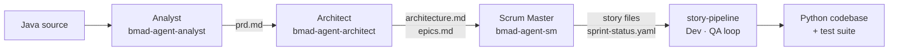
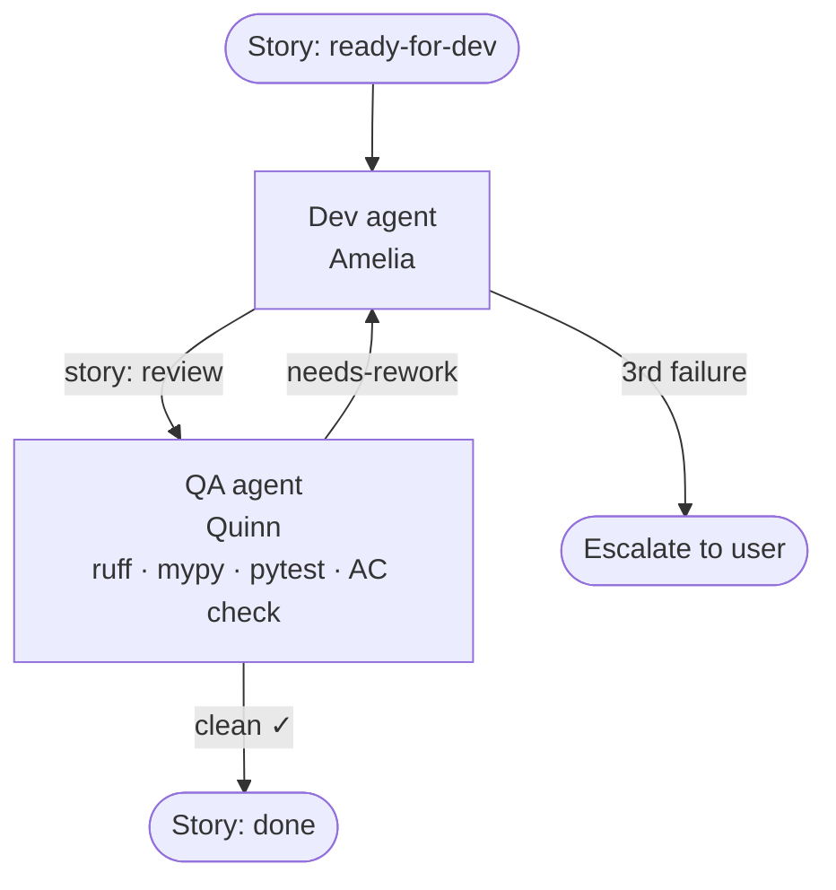

# Bank Management System — Java → Python Migration

Migrating [BankManagementSystem](https://github.com/aljalo/BankManagementSystem) from Java to modern Python, using **Pydantic** for runtime validation and an **AI agent pipeline** (Claude Code + BMad) to drive the entire planning and implementation lifecycle.

**3 epics · 13 stories · 90 tests · 100% coverage**

## Quick start

```bash
uv sync
uv run pytest          # 90 tests, 100% coverage
uv run bank --help     # launch the CLI
```

## BMAD methodology

The migration is orchestrated by four AI agent personas, each responsible for a distinct phase. Each phase produces a concrete artifact before the next begins.



### Phase 1 — Analysis (`bmad-agent-analyst`)

**Input:** Java source code (`docs/BankManagementSystem/`)
**Output:** [`specs/prd.md`](specs/prd.md)

The Analyst reads the Java codebase and extracts all business rules: numeric account number format, non-negative balance invariant, transactional semantics for deposit and withdrawal, duplicate-account prevention. It also flags Java pain points — manual null checks, mutable state, scattered validation — that Pydantic will address structurally.

### Phase 2 — Architecture (`bmad-agent-architect`)

**Input:** `specs/prd.md`
**Output:** [`specs/architecture.md`](specs/architecture.md) · [`specs/epics.md`](specs/epics.md)

The Architect designs the Python package structure, selects Pydantic `BaseModel` as the core data layer, and defines the three epics. Key technology choices are recorded as Architecture Decision Records (ADRs) in `specs/architecture.md`.

### Phase 3 — Sprint decomposition (`bmad-agent-sm`)

**Input:** `specs/epics.md`
**Output:** Story files in [`specs/implementation-artifacts/`](specs/implementation-artifacts/) · [`sprint-status.yaml`](specs/implementation-artifacts/sprint-status.yaml)

The Scrum Master breaks each epic into stories with explicit Acceptance Criteria and a technical focus per story (e.g. *"Story 1-3: Account model — Pydantic `BaseModel` with `field_validator` for account number format"*).

### Phase 4 — Implementation (`/story-pipeline`)

**Input:** Story files
**Output:** Working Python code + passing test suite

Each story is processed by the autonomous Dev → QA loop described below.

## Story pipeline — Dev → QA → Rework



**Dev (Amelia)** implements the story and writes `pytest` tests.
**QA (Quinn)** runs `ruff --fix`, `mypy --strict`, `pytest`, and verifies each Acceptance Criterion explicitly. Returns `clean` or `needs-rework` with labelled issue notes.

The loop auto-commits on every milestone via a `commit-step` hook.

### Trace: Story 2-1 — Create account command

Story 2-1 is a concrete example of the pipeline catching real issues. After iteration 1, QA returned `needs-rework`:

> **AC4 FAIL** — Typer parses `-100.0` as the option flag `-1` before Pydantic validation fires.
> Fix applied: wrap argument as `Annotated[float, typer.Argument()]`.
>
> **AC5 FAIL** — `show-accounts` exits silently; `get_all_accounts()` raises `NotImplementedError`.
> Fix applied: defer listing to Story 2-4; AC scoped correctly.

Iteration 2 resolved both. QA returned `clean ✓` — 73 tests passing, all 5 ACs satisfied.

Full traces for all three epics: [`specs/audit/`](specs/audit/)

## Pydantic adoption

The migration's core objective is replacing Java's manual, imperative validation with Pydantic's declarative model layer.

### Before — Java `Account.java`

```java
public Account(String accountNumber, String ownerName, double balance) {
    if (balance < 0) {
        throw new IllegalArgumentException("balance cannot be negative");
    }
    // No format validation on accountNumber — silent corruption possible
    this.accountNumber = accountNumber;
    ...
}
```

### After — Python `model.py`

```python
class Account(BaseModel):
    account_number: str = Field(min_length=1)
    owner: str = Field(min_length=1)
    balance: float = Field(ge=0.0)           # ≥ 0 enforced by Pydantic

    @field_validator("account_number")
    @classmethod
    def account_number_must_be_numeric(cls, v: str) -> str:
        if not v.isdigit():
            raise ValueError("Account number must be a numeric string (e.g., '001').")
        return v
```

What changed:

| Java | Python |
|------|--------|
| Manual `if/throw` per field | Declarative `Field(ge=0.0, min_length=1)` |
| No account number format check | `@field_validator` enforces numeric strings |
| Mutable object (`deposit()` mutates state) | Immutable — updates via `model_copy(update={...})` |
| No serialization support | `model_dump()` / `model_validate()` built-in |

## Project structure

```
.
├── docs/BankManagementSystem/       # Original Java source (reference input for Phase 1)
├── specs/
│   ├── prd.md                       # Product Requirements Document (Phase 1 output)
│   ├── architecture.md              # Architecture & ADRs (Phase 2 output)
│   ├── epics.md                     # Epics & stories (Phase 2 output)
│   ├── audit/                       # Pipeline execution traces, one file per epic
│   └── implementation-artifacts/
│       ├── sprint-status.yaml       # Sprint tracker
│       └── *.md                     # Individual story files (Phase 3 output)
├── src/bank/
│   ├── model.py                     # Account — Pydantic BaseModel
│   ├── repository.py                # In-memory AccountRepository
│   ├── service.py                   # BankService protocol + BankServiceImpl
│   ├── exceptions.py                # Domain exception hierarchy
│   └── cli.py                       # Typer CLI — create / deposit / withdraw / list
├── tests/                           # pytest suite — 90 tests, 100% coverage
├── .claude/
│   ├── settings.json                # Claude Code permissions & hook configuration
│   └── skills/                      # BMad agent and pipeline skill definitions
├── pyproject.toml
└── CLAUDE.md                        # Project-level instructions for Claude Code
```

## Running the CLI

```bash
# Create an account
uv run bank create-account 001 "Alice" 500.0

# Deposit funds
uv run bank deposit 001 200.0

# Withdraw funds
uv run bank withdraw 001 100.0

# List all accounts
uv run bank show-accounts
```